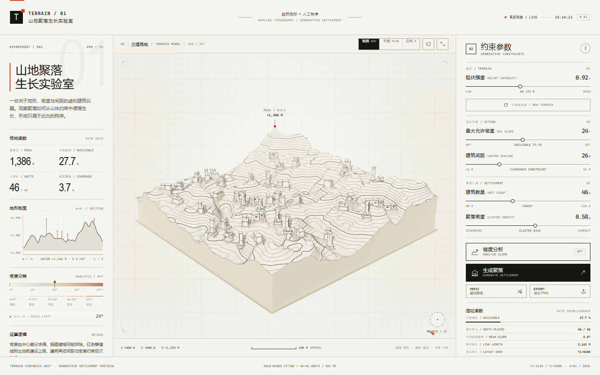
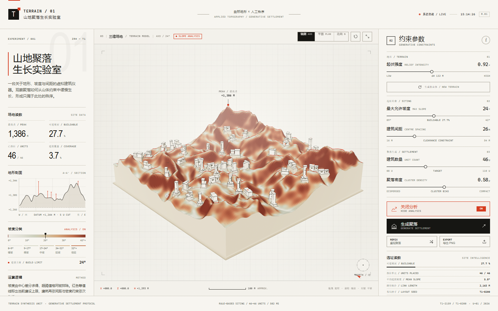
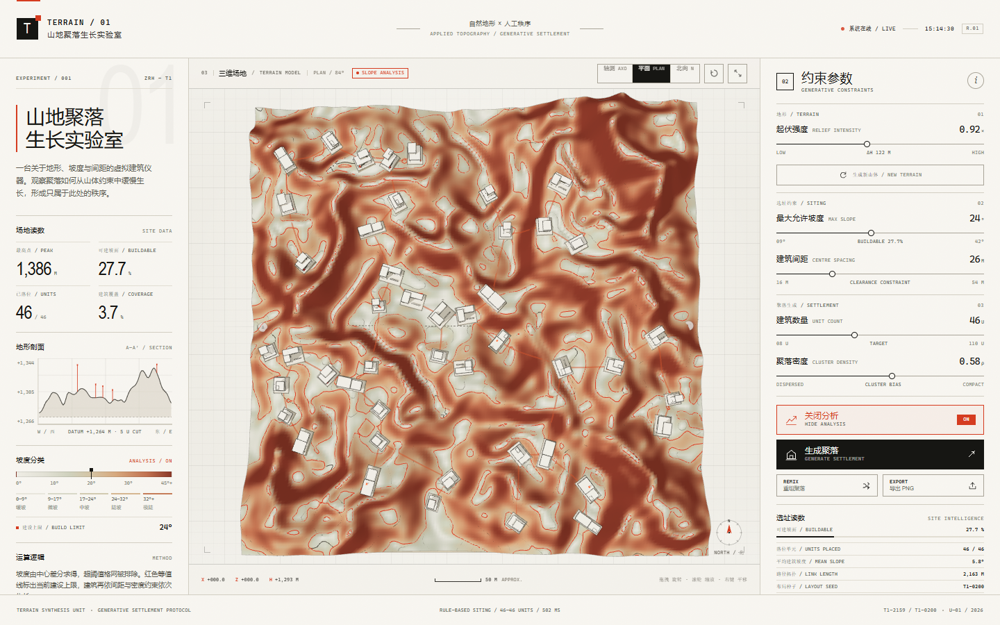

# TERRAIN / 01 — 山地聚落生长实验室

> 一台关于地形、坡度与间距的虚拟建筑仪器。  
> MOUNTAIN SETTLEMENT GROWTH LABORATORY

这是一个完全运行在浏览器中的三维生成式设计实验。地形、坡度与建筑选址共享同一套高度场数据：坡度由真实网格高差计算，建筑只出现在允许坡度以内，并按最小中心间距与密度约束逐栋生长。



*轴测视图：真实坡度计算下自动生长的山地聚落。*



*坡度分析：暖色—赤陶色表示地表坡度，红色细线为最大允许坡度的建设上限。*



*平面视图：同一场约束计算结果的正射式阅读。*

---

## 1. 启动方式

项目没有构建步骤，没有 npm 依赖，也不需要联网加载 Three.js。

### 方式 A — 直接打开

双击 `index.html`。  
所有脚本都是本地 classic script，因此在现代 Chrome / Edge 中可直接以 `file://` 运行。

### 方式 B — 本地服务器（推荐）

双击 `start.bat`，浏览器会自动打开：

```text
http://127.0.0.1:8123
```

也可以在项目目录运行：

```powershell
npm start
# 或
node server.mjs
```

若端口被占用：

```powershell
$env:PORT=8124; node server.mjs
```

> 推荐使用 Chrome 或 Edge，并开启硬件加速。  
> WebGL 不可用时页面会显示明确的提示，不会出现静默失败。

---

## 2. 交互一览

| 操作 | 说明 |
| --- | --- |
| 左键拖拽 | 旋转三维地形 |
| 滚轮 / 双指捏合 | 缩放 |
| 右键拖拽 / Shift + 左键拖拽 | 平移 |
| 点击建筑 | 打开单元档案（编号、海拔、坡度、层数、占地面积、基座高差） |
| 点击空白 | 取消选择 |
| 轴测 / 平面 / 北向 | 三个预设视角 |
| 自动环视按钮 | 缓慢持续环绕 |
| 坡度分析 | 扫描式叠加真实坡度分类，并绘制当前阈值的建设上限等值线 |
| 生成新山体 | 重新生成地形与聚落 |
| REMIX | 保持地形与约束，重新组织聚落布局 |
| 导出 PNG | 在当前相机视角下合成高清海报式 PNG |

### 快捷键

`A` 坡度分析 · `R` REMIX · `G` 生成聚落 · `E` 导出 PNG · `1` 轴测 · `2` 平面 · `3` 北向 · `O` 自动环视 · `0` 复位视角

Canvas 获得焦点后，方向键可旋转，`+ / -` 可缩放。

---

## 3. 计算逻辑

> 这不是“随机摆方块”。所有视觉状态都可以追溯到高度场计算。

### 3.1 地形

- 使用 seeded Perlin noise、fBm 与 ridged multifractal 叠加出山体，再以一条蜿蜒谷地切割地形；
- 160 × 160 网格（25,921 个高程采样点）；
- 经过 3 × 3 平滑、两次 separable 5-tap 平滑与高程曲线重塑，使坡度在场地尺度上可建；
- 高度场为唯一数据源，等值线、坡度、建筑基底、路径与剖面均从中派生。

### 3.2 坡度

- 在规则网格上计算中心差分：
  - `gx = (h[i+1] - h[i-1]) / (2·Δx)`
  - `gz = (h[j+1] - h[j-1]) / (2·Δz)`
  - `slope = atan(√(gx² + gz²)) · 180 / π`
- 超过最大允许坡度的格网不进入候选池；
- 坡度分析使用连续暖色—赤陶色分级，并叠加一条红色等值线，标示当前阈值的精确边界；
- 建筑落位还会检查场地周围局部坡度，避免建筑落在中心轻度超标、边缘却陡峭的位置。

### 3.3 选址与生长

1. 在带轻微抖动的网格上生成候选点（避开场地边缘）；
2. 检查中心坡度、邻域坡度和局部最大坡度；
3. 按平整度、遮蔽、南向日照、高程带进行基础评分；
4. 以贪心方式逐栋选点，严格执行最小中心间距；
5. 密度参数改变“向已有聚落靠近”的权重，形成从离散村落到紧凑山村的差异；
6. 选点顺序就是生长动画顺序。

可选约束不足时，页面会诚实显示 `LIMIT`，例如 `42 / 60 · CONSTRAINT LIMIT`，而不会伪造数量。

### 3.4 建筑

- 建筑长轴沿局部等高线方向旋转，窗面朝向坡下；
- 依据建筑四角与边中点的高程，切割出一块真实整平的基座；
- 四种程序化类型：庭院 / 塔楼 / 台地 / 长屋；
- 每栋建筑的高度、层数、体量组合与立面开口均来自同一种子链；
- 白色体量、深色窗带、红色竖向核心与细线轮廓共同表达极简建筑语言。

### 3.5 路径拓扑

- 用 Prim 最小生成树连接落位单元；
- 路径沿地形采样并偏移，形成贴地细带；
- 路径长度计入右侧“LINK LENGTH”读数，并非装饰。

---

## 4. 参数

| 参数 | 范围 | 影响 |
| --- | --- | --- |
| 起伏强度 RELIEF | 0.38 – 1.62 | 重新计算地形高差与所有坡度 |
| 最大允许坡度 MAX SLOPE | 9° – 42° | 候选池与建设上限等值线 |
| 建筑间距 CENTRE SPACING | 16 – 54 m | 两栋建筑中心点的最小距离 |
| 建筑数量 UNIT COUNT | 8 – 110 | 目标落位数量 |
| 聚落密度 CLUSTER DENSITY | 0.05 – 1.00 | 向已有聚落聚集的权重 |

调整参数后会自动重新计算；也可点击“生成聚落”重放生长序列。

---

## 5. 导出

点击 `EXPORT / 导出 PNG`：

- 以当前相机视角重新渲染至最高约 3400 px 的高分辨率画面（桌面预览通常约 2600 × 2470 px）；
- 合成纸张底色、精细测绘网格、项目标题、地块尺寸、种子、可建面积、平均坡度、路径长度和比例尺；
- 输出文件名示例：`TERRAIN-01_T1-2159_T1-0200_2630x2470.png`。

---

## 6. 项目结构

```text
terrain-01-mountain-settlement/
├─ index.html                 页面结构、UI 与无障碍标注
├─ css/
│  └─ style.css               Swiss / editorial 视觉系统、响应式布局
├─ js/
│  ├─ utils.js                平滑噪声、随机、色带与数字工具
│  ├─ terrain.js              高度场、坡度、等值线、剖面与阈值线
│  ├─ settlement.js           候选池、间距约束、选址、建筑程序与 MST 路径
│  └─ app.js                  Three.js 场景、轨道控制、动画、UI 与导出
├─ vendor/
│  ├─ three.min.js            Three.js r149（本地化，无需联网）
│  └─ THREE-LICENSE.txt       MIT 许可
├─ preview/
│  ├─ hero.png                轴测预览
│  ├─ analysis.png            坡度分析预览
│  └─ plan.png                平面预览
├─ server.mjs                 零依赖本地静态服务器
├─ package.json
├─ start.bat
└─ README.md
```

---

## 7. 技术说明

- **渲染**：Three.js r149，WebGLRenderer，ACES tone mapping，PCFSoftShadowMap，静态阴影缓存；
- **无依赖**：唯一的第三方库 Three.js 已本地化到 `vendor/`；
- **无外部资源**：字体使用系统中性无衬线 / 等宽字体，纹理、图标与图形均在页面内生成；
- **性能**：高度场与聚落求解为纯 TypedArray + JS 运算；阴影按需更新；像素比上限受控；
- **响应式**：宽屏为三栏仪器界面，中屏收起左栏，移动端改为纵向排列并保留完整交互；
- **可达性**：范围控件有 label 与动态 aria-valuetext，按钮具备 `aria-pressed` 状态，结果区域通过 `aria-live` 播报。

### URL 参数

可以直接分享某一组状态，例如：

```text
index.html?terrain=8537&layout=512&relief=0.92&slope=24&spacing=26&count=46&density=0.58
```

支持的参数：`terrain`, `layout`, `relief`, `slope`, `spacing`, `count`, `density`。

---

## 8. 浏览器支持

- Chrome / Edge：完整支持（含高清导出）；
- Firefox / Safari：核心三维与交互逻辑按现代 WebGL / Pointer Events 标准实现；下载与对话框细节可能因版本而异；
- 不建议在禁用 WebGL 或硬件加速的环境中使用。

---

## 9. 第三方许可

Three.js r149 — MIT License，完整许可文本见 [`vendor/THREE-LICENSE.txt`](vendor/THREE-LICENSE.txt)。
